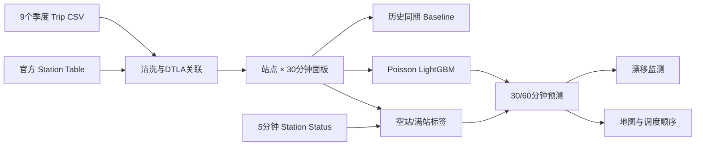

# DTLA BikeFlow

<div align="center">

**简体中文** · [English](README.en.md)

<br />

面向 DTLA Metro Bike Share 的站点级需求、可用性风险与概念漂移预测项目

<br />

[](pyproject.toml)
[](reports/data_audit.md)
[](docs/modeling.md)
[](.github/workflows/ci.yml)

</div>

## 项目解决什么问题？

BikeFlow 把 Metro Bike Share 行程转换为“一个站点 × 一个 30 分钟预测时刻”的时序面板，回答三个连续问题：

1. 每个 DTLA 站点未来 30/60 分钟会有多少出发和到达？
2. 在已有实时库存历史时，哪些站点会没车可借或没有空位可还？
3. 当站点、季节或需求分布发生变化时，应该固定、每周、每月还是按漂移触发重训？



## 当前数据

仓库下载器固定使用 Metro 官方公开链接，保存原始 ZIP、解压 CSV、文件大小和 SHA-256。当前本地数据审计结果：

| 指标 | 结果 |
|---|---:|
| 时间范围 | 2024-04-01 至 2026-06-30 |
| 季度文件 | 9 |
| 行程记录 | 1,027,489 |
| 出现过的站点 ID | 273 |
| DTLA 出发 | 593,813 |
| DTLA 到达 | 576,836 |
| DTLA → 外部 | 29,499 |
| 外部 → DTLA | 12,522 |
| 无法关联站点表的 ID | 0 |

完整分季度结果见 [`reports/data_audit.md`](reports/data_audit.md)。数据来源与字段定义见
[Metro Bike Share Data](https://bikeshare.metro.net/about/data/)。原始数据不提交到 Git；运行下载命令即可复现。

## 预测目标

最新全量实验与实际实现状态请优先阅读：

- [Step-by-step implementation guide](docs/step_by_step_guide.md)
- [Full-run results and operational report](reports/full_results_report.md)

2026-11-22 全量运行覆盖 150 个测试站点、639,897 个测试样本，实际模型为 sklearn Poisson
gradient boosting。整体 MAE 为 0.140041，RMSE 为 0.338774。相对季节均值，MAE 仅改善
0.17%，RMSE 改善 10.54%；始终预测零的 MAE 更低。下述 30/60 分钟流量与风险部分同时包含
已实现的数据目标和后续设计，目前训练入口只拟合 30 分钟出发量，尚未训练空站/满站分类器。

### 需求回归

```text
target_departures_30m
target_arrivals_30m
target_net_flow_30m = arrivals - departures

target_departures_60m
target_arrivals_60m
target_net_flow_60m
```

主模型使用适合非负计数目标的 Poisson LightGBM。环境没有 LightGBM 时自动退回 scikit-learn
`HistGradientBoostingRegressor(loss="poisson")`。历史同期均值和“上周同一时段”始终作为可审计 baseline。

macOS 上 LightGBM 还需要 OpenMP 运行库；若本机没有 `libomp`，CLI 会明确警告并自动使用上述
scikit-learn Poisson fallback，不会中断整个实验流程。

### 空站与满站风险

Trip Data 无法观测人工调度，因此不能独立重建真实库存。仓库提供实时状态采集器，每 5 分钟保存：

```text
bikes_available
docks_available
total_docks
station_status
connection_status
```

当积累历史快照后，标签定义为未来 30 分钟内连续两个快照为零：

```text
target_empty_30m = consecutive bikes_available == 0
target_full_30m  = consecutive docks_available == 0
```

详细限制和标签策略见 [`docs/availability-risk.md`](docs/availability-risk.md)。

## 仓库结构

```text
.
├── configs/                 数据、模型、漂移和时间切分配置
├── data/                    原始、处理中、模型面板和状态快照
├── docs/                    架构、建模、评估、漂移与 Dashboard 文档
├── experiments/             实验协议和可复现结果入口
├── reports/                 已生成的数据审计报告
├── scripts/                 下载、准备、训练和服务快捷入口
├── src/bikeflow/            Python 包与 CLI
├── tests/                   数据、特征、标签、指标和漂移单元测试
├── Dockerfile               Dashboard 容器入口
└── pyproject.toml           依赖、CLI 和开发工具配置
```

## 快速开始

以下命令都在仓库根目录执行。

### 1. 安装

```bash
bash scripts/setup.sh
source .venv/bin/activate
```

### 2. 下载和审计官方数据

```bash
bikeflow download
bikeflow audit
```

重复运行不会重新下载已有文件；`--force` 才会覆盖。下载记录位于
`data/raw/manifests/download_manifest.json`。

### 3. 构造训练面板

```bash
bikeflow prepare
```

面板按站点分区保存为 Parquet。每行预测时刻只使用已经完成的时间窗口；目标来自未来窗口，避免时间泄漏。

### 4. 训练与评估

```bash
bikeflow train
```

默认切分：

| Split | 时间 |
|---|---|
| Train | 2024-04-01 至 2025-12-31 |
| Validation | 2026-01-01 至 2026-03-31 |
| Test | 2026-04-01 至 2026-06-30 |

模型、预测与指标写入 `artifacts/`。调试时可限制加载量：

```bash
bikeflow train --max-rows 500000
```

### 5. 采集实时站点状态

```bash
bikeflow collect-status
```

生产环境应由 cron、Airflow 或其他调度器每 5 分钟执行。每次调用同时保留原始 GeoJSON 和规范化 Parquet。

### 6. 比较重训练策略

```bash
bikeflow backtest --strategy fixed --strategy monthly --strategy drift_triggered
```

回测以周为评估窗口，记录每种策略的拟合次数、误差、PSI 与触发原因。开发时可用
`--max-rows` 和 `--max-training-rows` 控制资源占用。

### 7. 启动 Dashboard

```bash
bash scripts/dashboard.sh
```

Dashboard 默认读取最新预测和最新状态快照，显示站点地图、需求等级、库存以及测试集 MAE/WAPE。

## 特征设计

- 需求滞后：1、2、3、48、336、672、1008、1344 个 30 分钟窗口；
- 滚动流量：1 小时、3 小时、24 小时和 7 天；
- 流入、流出和净流量分别计算；
- 小时、星期、周末、月份和周期正余弦编码；
- 站点 ID、经纬度、上线时长；
- 最近站点与 Haversine 距离映射；
- 有库存历史后加入当前车辆、空位、容量和可用率。

经纬度用于站点空间关系和新站 cold-start，不把 DTLA 粗暴切成手工区域。跨边界流量按起点和终点分别计算，避免漏掉“外部 → DTLA”和“DTLA → 外部”。

## 评估与漂移

需求模型报告 MAE、RMSE、WAPE 和 Bias，不使用容易被大量零值破坏的 MAPE。风险模型应报告 PR-AUC、Brier Score、Recall@K 和概率校准。

漂移策略配置在 [`configs/drift.yaml`](configs/drift.yaml)：

- fixed：训练一次后保持不变；
- weekly：每周重训；
- monthly：每月重训；
- drift-triggered：滚动误差或 PSI 超阈值后重训。

工作日和周末差异首先视为可学习季节性；持续残差恶化、新站上线和长期站点分布变化才作为漂移信号。详见 [`docs/drift.md`](docs/drift.md)。

## 可复现性与边界

- 原始下载保留 SHA-256，处理配置进入 Git；
- 原始数据、模型和状态快照不进入 Git；
- `station_id=3000` Virtual Station 不作为实体站点建模；
- 官方站点表只有当前状态，没有历史停用日期；面板默认按站点首次和最后一次观测范围构造；
- 在没有状态历史前，系统只输出需求与库存压力，不把它表述为真实空站概率；
- 季度切分完全按时间进行，不随机打乱未来记录进入训练集。

## 文档

- [文档索引](docs/README.md)
- [系统架构](docs/architecture.md)
- [数据流水线](docs/data-pipeline.md)
- [需求模型](docs/modeling.md)
- [可用性风险](docs/availability-risk.md)
- [评估协议](docs/evaluation.md)
- [概念漂移与重训](docs/drift.md)
- [Dashboard 与调度输出](docs/dashboard.md)
