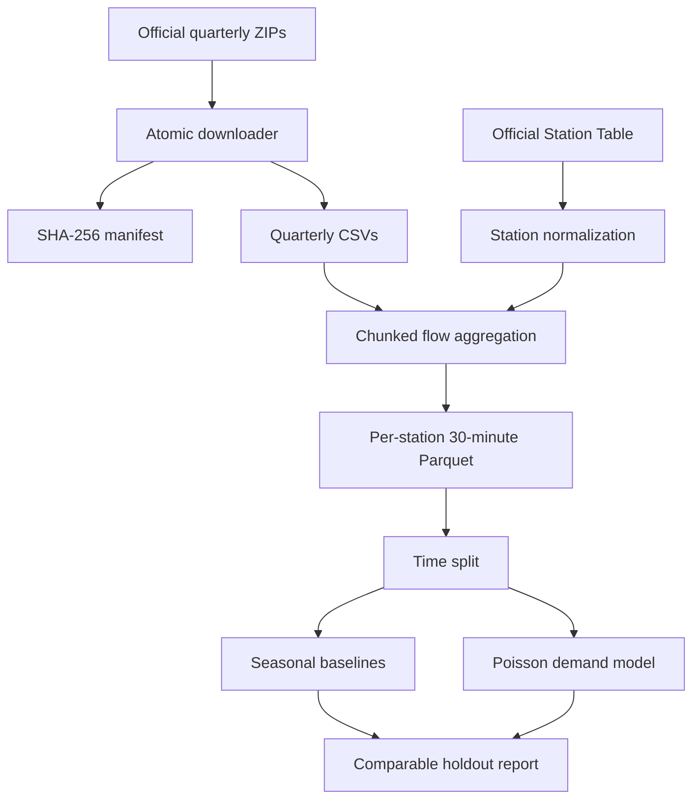
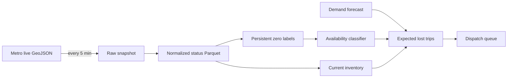

# Architecture

## Offline training path

Trip files are read in chunks. The pipeline does not build one giant trip DataFrame. Departures and
arrivals are aggregated separately before a dense panel is produced for each observed DTLA station.
Per-station Parquet partitions keep feature generation and downstream loading inspectable.

## Online status path

The status collector deliberately keeps both the source JSON and a normalized table. This supports
schema audits and prevents a future parser change from destroying the original evidence.

## Storage contracts

| Layer | Contract | Git policy |
|---|---|---|
| `data/raw` | Immutable downloaded bytes and extraction manifest | ignored |
| `data/interim` | Cleaned or normalized temporary data | ignored |
| `data/processed` | Model-ready station panel | ignored |
| `data/status` | Timestamped inventory snapshots | ignored |
| `artifacts` | Models, predictions, and metrics | ignored |
| `reports` | Small human-readable audits | committed |

