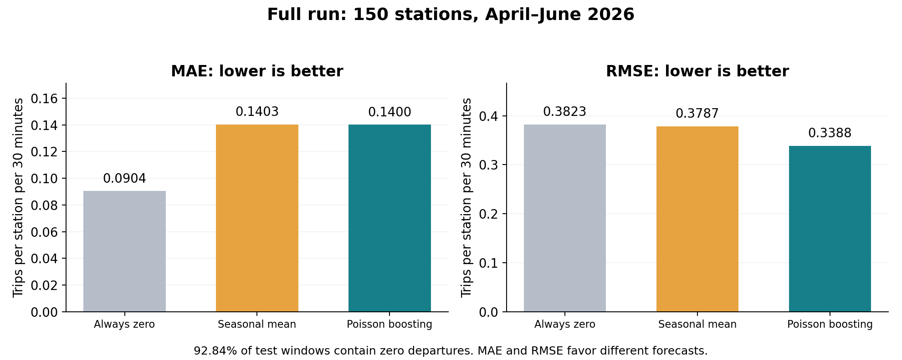
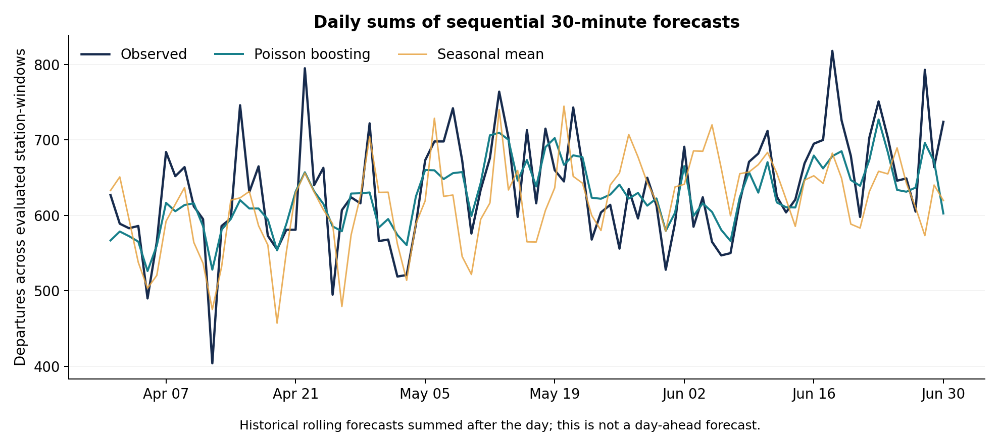
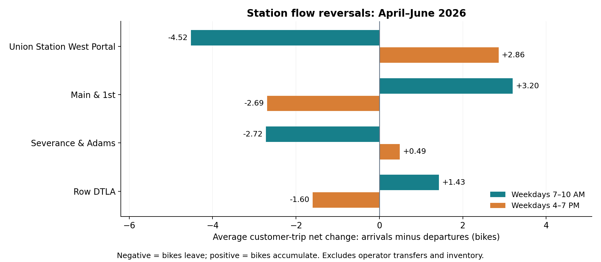

# DTLA BikeFlow: full-training results and operational findings

Report date: November 22, 2026, America/Los_Angeles.
Model saved: November 22, 2026 at 16:32 PST (November 23 at 00:32 UTC).

## Executive assessment

The project has a functioning pipeline for 30-minute station departure forecasting. It downloaded
1,027,489 trips, constructed 5,798,715 station-time rows, and completed a full run with 150 evaluated
stations and 639,897 test observations from April–June 2026. The actual trained model is
scikit-learn Poisson histogram gradient boosting, selected automatically because LightGBM could not
load the macOS OpenMP library.

The main predictive result is **lower squared error, with almost unchanged overall absolute error**.
Compared with the four-week seasonal mean, RMSE improved by 10.54%, but MAE improved by only 0.17%.
An exploratory week-block bootstrap does not establish a clear overall MAE advantage. Because
92.84% of station-time targets are zero, an always-zero predictor achieves lower MAE than the model.
This is a material weakness, not a metric to omit.

Benefits are more apparent at busy stations and after aggregation. The highest training-volume
quartile improves MAE by 3.85%. Daily sums of the sequential forecasts achieve 5.57% WAPE versus
8.87% for the seasonal baseline. Those daily sums are not day-ahead forecasts, because later
half-hour predictions can use earlier observed activity from the same day.

Separately, raw trip analysis identifies useful operating patterns: Union Station West Portal tends
to lose bikes during weekday mornings and gain them during evenings; Main & 1st has the reverse
pattern. These support inventory-check priorities. Exact delivery quantities and reduced stockout
rates have not been demonstrated because time-aligned inventory and operator-transfer histories are
not available for this study.

## 1. Scope and implemented objectives

The primary implemented target is the number of recorded departures from a station over the next
30 minutes. At forecast origin `t`, the target covers `[t, t + 30m)` and features come from
completed intervals before `t`.

| Component | Status of the measured run |
|---|---|
| Historical data download and audit | Executed across nine quarters |
| Station-by-half-hour panel | Built for 180 historically observed station IDs |
| 30-minute departure model | Trained and evaluated across all eligible partitions |
| 30/60-minute arrival and net-flow targets | Prepared, but no corresponding trained models |
| 60-minute departure target | Prepared, but no trained 60-minute model |
| Empty/full classification | Collector and preliminary labels exist; no trained classifier |
| Neighbor flow | Nearest-station utility exists; not a fitted model feature |
| Retraining strategies | Experimental code exists; full comparison not executed |
| Dashboard | Saved historical predictions and station metadata displayed |
| Truck routing or exact bike transfers | Not implemented or evaluated |

The geographic definition uses the official station table's `Region == DTLA`. This is the project's
operational grouping, not a verified Downtown LA polygon. The selected table also contains station
names outside a narrow downtown core; enforce a geographic polygon before describing the study as
strictly bounded to Downtown LA.

## 2. Data and provenance

The source registry contains the official quarterly files from 2024 Q2 through 2026 Q2, a 27-month
period. There are 273 observed station IDs across the complete network, all matched to the downloaded
station table dated July 15, 2026.

| Data quantity | Value |
|---|---:|
| Raw trip rows | 1,027,489 |
| Quarterly files | 9 |
| Official-region DTLA starts | 593,813 |
| Official-region DTLA ends | 576,836 |
| DTLA to outside | 29,499 |
| Outside to DTLA | 12,522 |
| Prepared station partitions | 180 |
| Prepared station-time rows | 5,798,715 |
| Eligible evaluated test stations | 150 |
| Test half-hour observations | 639,897 |
| Observed departures in evaluated test rows | 57,854 |

The test targets contain fewer trips than the raw Q2 DTLA-start total of 58,615 because feature
warm-up, station observation boundaries, and target coverage limit eligible rows. Thirty of the
180 historical partitions have no usable test predictions. The machine-readable analysis lists them.

The original development run evaluated only 12 stations after loading the first 500,000 panel rows.
Its MAE of 0.2392 must not be directly compared with the new MAE as evidence of improvement from
additional training: the station population and test composition changed. The values in this report
all refer to the full saved run unless explicitly labeled descriptive raw-trip analysis.

Raw download hashes are retained locally. The expanded report analysis records hashes of the saved
model, prediction file, summary, and current configuration files, plus installed dependency versions.
The trainer did not freeze configuration snapshots or the environment at fitting time, so current
config hashes alone cannot prove historical configuration identity.

## 3. Method

Departures and arrivals are aggregated independently, preserving trips across the region boundary.
Station 3000, the Virtual Station, is not modeled as a physical location. A regular half-hour grid
between each station's first and last event supplies zero-count intervals.

There are 48 fitted numeric features: station ID, latitude, longitude, station age, calendar
indicators and cycles, departures/arrivals/net-flow lags, and rolling sums. The longest lag is four
weeks. The builder excludes training rows with missing required features or targets.

The model estimates observed rental counts, not unmet demand. Availability constraints can suppress
recorded trips, so low observed demand does not necessarily imply low rider interest.

| Period | Dates | Eligible rows |
|---|---|---:|
| Train | 2024-04-01–2025-12-31 | 4,295,051 |
| Validation | 2026-01-01–2026-03-31 | 645,275 |
| Test | 2026-04-01–2026-06-30 | 639,897 |

The saved estimator is `HistGradientBoostingRegressor(loss="poisson")`, with learning rate 0.05,
maximum 500 iterations, maximum 63 leaves, L2 regularization 1.0, and random seed 42. It completed
500 iterations. The preferred LightGBM configuration was not the fitted estimator.

The repository creates a chronological validation set, but the fallback estimator uses its own
automatic internal validation split rather than explicitly using that chronological frame. This
must be improved before claiming a fully chronological tuning or early-stopping experiment. No
hyperparameter search, feature ablation, or causal feature-importance analysis was performed.

## 4. Overall test performance

MAE and RMSE are measured in trips per station per 30-minute window; lower is better. Bias is
prediction minus actual. WAPE divides total absolute error by total actual trips, and is not an
accuracy percentage.

| Predictor | MAE | RMSE | WAPE | Bias |
|---|---:|---:|---:|---:|
| Always zero | **0.090411** | 0.382310 | **100.00%** | -0.090411 |
| Four-week seasonal mean | 0.140276 | 0.378681 | 155.15% | -0.002589 |
| Poisson gradient boosting | 0.140041 | **0.338774** | 154.89% | **-0.001239** |



Relative to the seasonal baseline, the learned model improves MAE by **0.17%** and RMSE by
**10.54%**. Relative to always zero, its MAE is **54.89% higher**. A low absolute MAE is therefore
insufficient evidence that the forecasting system is useful.

Across evaluated rows, observed departures total 57,854 and model predictions sum to 57,061.24,
an aggregate underprediction of 1.37%. Small aggregate bias can coexist with large individual
errors because positive and negative errors cancel. Likewise, near-correct totals do not establish
well-calibrated station-level probabilities or inventory recommendations.

### 4.1 Why the metrics disagree

There are **594,098 zero-demand windows** and **45,799 positive-demand windows**. The target is zero
in 92.84% of rows, so the unconditional median is zero. Absolute-error metrics naturally favor
zero predictions in many such situations, whereas a Poisson objective estimates a conditional mean
and penalizes large missed counts differently.

| Test subset | Rows | Model MAE | Seasonal MAE | Always-zero MAE |
|---|---:|---:|---:|---:|
| Zero departures | 594,098 | 0.07379 | 0.07258 | 0.00000 |
| Positive departures | 45,799 | 0.99945 | 1.01838 | 1.26322 |

The learned model helps on positive windows, but only modestly relative to the seasonal baseline.
These outcome-defined subsets are retrospective diagnostics; actual future positivity is not known
when making a forecast.

### 4.2 Uncertainty in the tiny overall MAE improvement

A paired bootstrap resampling 14 calendar-week blocks, with 2,000 draws and seed 42, gives:

```text
MAE(model) - MAE(seasonal) = -0.000235 trips per station-window
Exploratory 95% bootstrap interval: [-0.001716, +0.001062]
```

The interval includes zero, so this analysis does not establish a reliable overall MAE improvement.
The bootstrap has few blocks from one quarter, and cannot establish stationarity or operational
effectiveness. The stronger RMSE point estimate should also be validated on later dates.

## 5. Where the model helps

### 5.1 Station volume

Station quartiles are assigned using **training-period trip totals**, among the evaluated stations
with training history. This avoids using test-period traffic to define those quartile groups.

| Training-volume group | Test rows | Model MAE | Seasonal MAE | Model RMSE | Seasonal RMSE |
|---|---:|---:|---:|---:|---:|
| Q1 lowest | 161,163 | 0.07709 | **0.07267** | **0.22671** | 0.25019 |
| Q2 | 156,866 | 0.10140 | **0.09760** | **0.27539** | 0.30402 |
| Q3 | 152,422 | 0.12228 | **0.12080** | **0.29770** | 0.33169 |
| Q4 highest | 161,462 | **0.25684** | 0.26712 | **0.48968** | 0.55017 |
| No training history | 7,984 | **0.14674** | 0.15002 | **0.35990** | 0.43807 |

The busiest quartile improves MAE by **3.85%**. Lower-volume quartiles get worse on MAE even though
they improve on RMSE. This supports evaluating a validation-selected station-group policy, rather
than assuming one estimator is best everywhere. Always zero still has lower MAE even in the busiest
quartile, so an operating-cost metric is needed before adopting such a policy.

Across the 150 test stations, the model beats the seasonal baseline on MAE at **56 stations** and on
RMSE at **all 150**. These are measured point estimates, not station-by-station significance tests.

### 5.2 Selected busy stations

The following stations are selected by observed test volume for descriptive inspection; they are
not a preselected deployment cohort.

| Station | Evaluated trips | Model MAE | Seasonal MAE | MAE improvement |
|---|---:|---:|---:|---:|
| 7th & Flower | 3,703 | 0.6084 | 0.6928 | 12.17% |
| Olive & 8th | 1,536 | 0.3837 | 0.4141 | 7.36% |
| Grand & 8th | 1,527 | 0.3944 | 0.4416 | 10.68% |
| Figueroa & 8th | 1,509 | 0.3964 | 0.4463 | 11.18% |
| Hope & Olympic | 1,247 | 0.3294 | 0.3533 | 6.75% |
| Union Station West Portal | 1,141 | 0.3297 | 0.3321 | 0.73% |
| Figueroa & 9th | 1,060 | 0.2904 | 0.3408 | 14.76% |
| 1st & Central | 1,057 | 0.3388 | 0.3368 | -0.60% |

Operationally interesting flow patterns and prediction improvements are different findings. Union
Station has a clear directional flow pattern but only a small MAE improvement over the baseline.

### 5.3 Weekdays, weekends, and months

| Subset | Model MAE | Seasonal MAE | Model RMSE | Seasonal RMSE |
|---|---:|---:|---:|---:|
| Weekdays | **0.14196** | 0.14304 | **0.34057** | 0.38071 |
| Weekends | 0.13526 | **0.13340** | **0.33427** | 0.37357 |
| April 2026 | 0.13354 | **0.13302** | **0.32538** | 0.36251 |
| May 2026 | 0.14208 | **0.14137** | **0.34050** | 0.38128 |
| June 2026 | **0.14439** | 0.14634 | **0.34983** | 0.39148 |

The overall MAE advantage is concentrated in weekdays and June, rather than consistent across
every month and day type. This motivates later-period evaluation and seasonal diagnostics; it does
not by itself prove concept drift.

## 6. Aggregate daily forecasting behavior

Summing each day's sequential half-hour predictions across available evaluated stations yields:

| Predictor | Daily MAE, trips | Daily RMSE, trips | Daily WAPE |
|---|---:|---:|---:|
| Seasonal mean | 56.40 | 69.99 | 8.87% |
| Poisson boosting | **35.44** | **47.47** | **5.57%** |

Daily MAE improves by **37.17%** relative to the seasonal baseline. This suggests the model tracks
aggregate activity better than it localizes individual station-window demand.



These totals aggregate predictions made at different times throughout a day. They must not be
reported as day-ahead forecast accuracy. Opposing station-level errors can also cancel, making
aggregation substantially easier than exact station inventory management. The evaluated station
set changes with availability of eligible rows; this table is not a complete all-station network
census on every day.

## 7. Operational findings from historical flows

This section independently aggregates raw trip starts and ends. It is descriptive analysis, not
output from an arrival model or evidence of successful stockout prevention. The examples use
stations labeled Active in the July 15 station table and launched on or before April 1, 2025.
Weekday averages include all 65 Monday–Friday dates in Q2 2026, including holidays and zero-trip
days. Times are local; windows exclude the stated end time.

| Station | Weekday window | Departures/day | Arrivals/day | Net change/day | Suggested inventory check |
|---|---|---:|---:|---:|---|
| Union Station West Portal | 07:00–10:00 | 5.72 | 1.20 | **-4.52** | Check bikes before 07:00 |
| Severance & Adams | 07:00–10:00 | 3.11 | 0.38 | **-2.72** | Check morning bike supply |
| Main & 1st | 07:00–10:00 | 0.95 | 4.15 | **+3.20** | Preserve empty docks |
| Main & 1st | 16:00–19:00 | 3.98 | 1.29 | **-2.69** | Retain enough bikes for evening |
| Union Station West Portal | 16:00–19:00 | 3.23 | 6.09 | **+2.86** | Preserve evening dock space |
| Row DTLA | 16:00–19:00 | 1.89 | 0.29 | **-1.60** | Check supply before 16:00 |

Net change is arrivals minus departures; negative means customer trips reduce inventory.



### Union Station: recurring weekday morning depletion

Between 07:00 and 10:00, departures exceed arrivals on **89.23% of Q2 2026 weekdays**. Average
morning net losses are 2.86 bikes in Q2 2024, 3.57 in Q2 2025, and 4.52 in Q2 2026. The pattern
supports higher morning inspection priority when opening inventory is low. It does not mean a truck
must deliver 4.52 or five bikes every day.

The corresponding Q2 2026 weekend net loss is only **0.19 bikes** per morning, so a uniform
seven-day replenishment schedule would not reflect the observed pattern.

### Main & 1st: morning arrivals can support evening departures

Morning customer flows add about 3.20 bikes, followed by a 2.69-bike evening loss. Removing all
apparent morning surplus could reduce evening supply. Operators should consider the later departure
period when deciding how many bikes to collect, while preserving enough dock space for morning
returns. Historical trip data alone cannot determine the optimal balance.

### 7th & Flower: high activity is different from persistent imbalance

On weekdays between 16:00 and 19:00, this station averages 13.26 departures and 12.85 arrivals, a net
loss of only 0.42 bikes. It warrants frequent monitoring because of high turnover, but the three-hour
totals alone do not justify a large one-way delivery. Intrawindow sequencing can still cause an
empty or full interval even when the end-of-window net flow is nearly balanced.

### 1st & Central: a candidate for reassessing old schedules

Weekday morning customer flow shifts from a net gain of 0.71 bikes in Q2 2025 to a net loss of 1.60
in Q2 2026. This justifies checking whether a historical allocation rule is stale. Station changes,
rebalancing, service availability, and local demand could all contribute; the current analysis does
not identify the cause or prove formal concept drift.

## 8. What these results do not establish

1. **No measured stockout/full-station performance.** Historical inventory labels are missing; the
   saved classifier does not exist. Empty/full probabilities and prevented lost trips cannot be reported.
2. **No exact bike-transfer quantities.** Current bikes, capacity, disabled equipment, operator
   transfers, and uncertainty must be considered before issuing a delivery order.
3. **No causal effect of dispatch.** Observed net flow does not show what would happen under a new
   rebalancing policy. A simulation or controlled operational evaluation is required.
4. **No completed retraining comparison.** The old backtest artifact is a small fixed-model
   development run, not evidence that weekly, monthly, or drift-triggered retraining is best.
5. **No fresh live forecast.** The Dashboard displays historical test predictions and joins a
   separately collected status snapshot without time alignment. Its demand colors are relative bins.
6. **No fully validated production time model.** Local timestamps lack explicit daylight-saving
   treatment, historical station closures are approximated by observed event bounds, and data-feed
   latency at the forecast origin has not been measured.
7. **No demonstrated untouched final benchmark.** The test quarter has been inspected repeatedly.
   Future feature/model selection should use validation or rolling development periods, with a later
   untouched quarter reserved for final evaluation.

## 9. Recommended next experiments

| Priority | Action | Evidence required |
|---|---|---|
| 1 | Use chronological validation for tuning and stopping | Improvement over zero and seasonal baselines on frozen later data |
| 2 | Align model objective and business cost | Cost of missed departures versus unnecessary replenishment; quantile or two-stage alternatives |
| 3 | Train arrival and 60-minute models | Comparable horizon-specific flow metrics |
| 4 | Collect regular status history and validate labels | Complete future windows, operational flags, inventory/capacity quality |
| 5 | Implement probability calibration and inventory risk | PR-AUC, Brier score, event recall, Recall@K |
| 6 | Test neighbor flow and station-group policies | Time-safe joins and validation-selected ablations |
| 7 | Run the full retraining comparison | Identical forecast windows, recorded fit counts/cost, frozen drift thresholds |
| 8 | Evaluate dispatch in simulation or a pilot | Reduced minutes empty/full and lost-trip estimates at a measured operating cost |

Installing `libomp` would allow the preferred LightGBM experiment, but changing the backend alone
is not guaranteed to improve results. The highest-value methodological changes are stronger
evaluation, time-aligned inventory data, and an objective that reflects operational costs.

## 10. Reproduction and evidence

The complete explanation and commands are in the [step-by-step guide](../docs/step_by_step_guide.md).
To re-analyze the already saved full run without training again:

```bash
cd "/Users/exusee_tim/Documents/ChatGPT/bike project"
source .venv/bin/activate
python scripts/analyze_results.py
```

To regenerate figures inside the same environment, install the optional report dependencies once:

```bash
python -m pip install -e '.[report]'
python scripts/plot_results.py
```

The figures in this report were rendered with an already available local Matplotlib installation.
The analysis script checks saved metric reproduction, finite/nonnegative forecasts, unique
station-time keys, and reconciliation of slice counts. Regenerating JSON and charts does not update
this narrative automatically; review the text after a different model run.

Evidence files:

- [Expanded analysis and artifact hashes](full_run_analysis.json).
- [Original source-data audit](data_audit.md).
- Current local `artifacts/training_summary.json`, `test_predictions.parquet`, and `demand_model.joblib`.
- `scripts/analyze_results.py` and `scripts/plot_results.py` for reproducible calculations and figures.
- [Official Metro data page](https://bikeshare.metro.net/about/data/) for source discovery, as recorded
  in the existing manifest; this report did not re-download or verify newly published quarters.

The prediction-file SHA-256 for the report is
`a8aa8c61d97c1eb0ba9b66ae747d1c8768c1284c58f5d5283bc63c3c0651b94d`.
